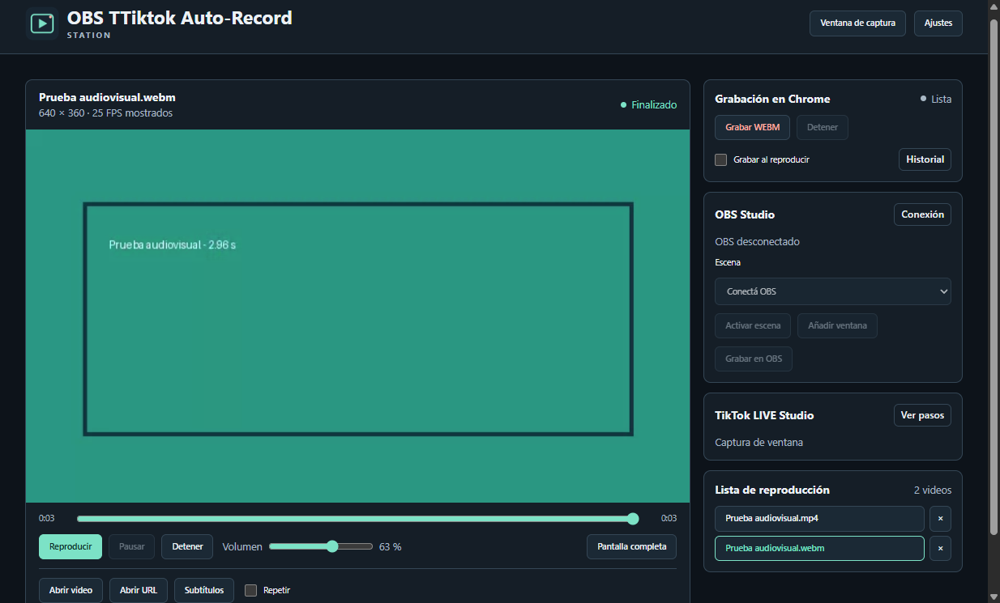

# OBS TTiktok Auto-Record

Estación de video para Chrome en Windows. Reproducí archivos y enlaces directos autorizados sin DRM, grabá en WEBM o compartí la ventana de Station con OBS Studio y TikTok LIVE Studio.

**[Descargar la extensión V1.0 en ZIP](https://github.com/Shocksua/OBS-TTiktok-Auto-Record/releases/download/v1.0.0/OBS-TTikTok-Auto-Record-Chrome-V1.0.zip)** · [Manual en PDF](docs/Manual%20OBS%20TTiktok%20Auto-Record%20V1.0.pdf)

El ZIP trae el código de la extensión y el manual en PDF dentro de `docs/`. Para instalarla, usá Google Chrome 116 o posterior en Windows.

## Instalación

1. Descomprimí el ZIP en una carpeta que puedas conservar.
2. Abrí `chrome://extensions` y activá **Modo desarrollador**.
3. Pulsá **Cargar descomprimida** y seleccioná la carpeta que contiene `manifest.json`.
4. En el menú de extensiones de Chrome, elegí **OBS TTiktok Auto-Record** y pulsá **Abrir estación**.

## Reproducción, directo y grabación

- **Reproducir.** Usá **Abrir video** para archivos como MP4 o WEBM, o **Abrir URL** para un enlace directo compatible. Station incluye lista de reproducción, repetición y subtítulos WebVTT.
- **Mostrar Station en un directo.** Pulsá **Ventana de captura**. En OBS Studio o TikTok LIVE Studio, agregá **Captura de ventana**, seleccioná **STATION** y comprobá la imagen y el audio. Iniciá la transmisión desde el programa que uses para el directo.
- **Guardar una copia.** Pulsá **Grabar WEBM** o activá **Grabar al reproducir** en Station. El archivo queda en la carpeta de descargas configurada en Chrome y se puede localizar desde **Historial**.
- **Controlar OBS.** La conexión por WebSocket permite seleccionar una escena, añadir la ventana de Station e iniciar o detener una grabación de OBS desde la extensión.

## Documentación

- [Instalación y configuración](docs/instalacion.md)
- [Manual de uso](docs/manual.md)
- [Formatos, fuentes y limitaciones](docs/limitaciones.md)
- [Informe y reproducción de pruebas](docs/pruebas.md)

## Código fuente

`manifest.json` define la extensión Manifest V3. `station/` contiene la interfaz y `modules/` contiene el reproductor, el grabador y el cliente de OBS. `tests/` incluye pruebas unitarias y un recorrido con clips sintéticos.
